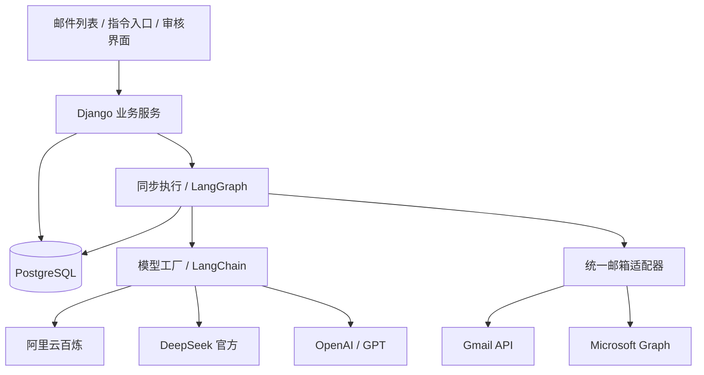

# Email Agent 项目架构与执行计划

## 目标与范围

使用 Django、PostgreSQL、LangChain 和 LangGraph，连接 Gmail 与 Outlook，提供邮件分类、摘要、事项提取、回复草稿、人工审核、处理偏好、去重和自然语言指令。

核心闭环：真实邮箱检索与读取 → 生成有来源证据的处理建议 → 用户修改、确认或取消 → 执行并核对结果 → 暂停、重启或故障后正确继续。

首版“执行任务”指审核后创建和更新内部待办。Jira、日历等外部业务动作按后续扩展接入。

## 架构与职责

当前采用模块化 Django 单体，同步执行工作流。Web 和命令行共用执行入口，PostgreSQL 保存业务状态、结果和检查点。运行到人工审核时保存状态并结束请求，审核后用新请求继续。



| 组件 | 职责 | 约束 |
|---|---|---|
| Django | 登录、权限、审核、业务规则、同步执行入口 | 所有用户数据访问检查所属用户 |
| PostgreSQL | 邮件、任务、草稿、审批、偏好、结果、检查点 | 唯一约束、事务和业务幂等兜底 |
| LangChain | 模型调用、结构化输出、工具适配 | 平台能力差异单独验证 |
| LangGraph | 分支、暂停、恢复、错误路由 | 检查点不能替代业务操作记录 |
| 邮箱适配器 | OAuth、检索、读取、草稿、发送、同步 | 原生 API 差异保留在适配器内 |
| 审核界面 | 原文、提取证据、草稿、动作清单 | 审批绑定具体内容和版本 |

## 项目目录

```text
agent-project/
├── config/
│   ├── settings/
│   │   ├── base.py                  # 公共配置和环境变量
│   │   ├── development.py           # 本地开发
│   │   ├── production.py            # 生产安全配置
│   │   └── test.py                  # 真实 PostgreSQL 测试
│   └── urls.py                      # 登录、控制台和探针入口
├── email_agent/
│   ├── models/
│   │   └── operations.py            # 运行、操作记录和审计
│   ├── intelligence/
│   │   └── models.py                # 三平台模型工厂
│   ├── services/
│   │   ├── runs.py                  # 同步启动、审核和手动恢复
│   │   ├── audit.py                 # 幂等审计与已知敏感信息脱敏
│   │   └── health.py                # 基础设施健康检查
│   ├── workflows/
│   │   ├── checkpoints.py           # PostgreSQL 检查点连接与初始化
│   │   └── probe.py                 # 阶段 0 持久化诊断图
│   ├── management/commands/         # 初始化、检查和诊断命令
│   ├── migrations/                  # Django 业务表迁移
│   ├── templates/                   # 登录与诊断控制台
│   ├── views.py                     # HTTP 层和用户权限边界
│   └── admin.py                     # 只读业务运维视图
├── tests/                           # 单元测试与 PostgreSQL 集成测试
├── scripts/
│   ├── init_env.py                   # 不覆盖已有配置的初始化脚本
│   └── verify_runtime.py             # 跨进程和重启恢复验证
├── docs/IMPLEMENTATION_PLAN.md       # 本执行计划
├── .github/workflows/ci.yml          # 持续集成
├── .env                             # 本地真实配置，禁止提交
├── .env.example                     # 环境变量模板
├── compose.yaml                     # 数据库与可选 Web 容器
├── Dockerfile                       # 开发验证应用镜像
├── pyproject.toml                   # uv 依赖和工具配置
├── uv.lock                          # 精确依赖解析结果
└── README.md                        # 启动与验证说明
```

后续新增 `providers/`（Gmail / Outlook）、`ingestion/`（增量同步和清洗）、`intelligence/schemas.py`（结构化数据）、`workflows/mail_processing.py`（真实邮件工作流）以及相应业务模型。按功能增长增添模块，不预先放置大量空目录。

## 分阶段执行计划

| 阶段 | 功能与实现顺序 | 验收标准 |
|---|---|---|
| 0：基础设施 | PostgreSQL、环境变量、用户登录、同步入口、检查点、操作记录、三平台模型工厂、诊断流程、测试 | 请求内完成当前阶段；暂停位置跨进程保留；手动恢复和重复确认不重复写入 |
| 1：真实邮箱只读接入 | 先验证两平台 OAuth 可行性；优先完成常用邮箱的搜索、分页、正文和会话读取 | 可以查询真实邮件；令牌刷新、撤销授权、断线重连可处理 |
| 2：邮件理解 | 清洗正文；分类、摘要、任务候选、日期、负责人和依赖；回复草稿；业务去重 | 结果附邮件来源与证据；歧义进入待确认；评估集可回归 |
| 3：审核与执行 | 草稿编辑、任务编辑、确认、拒绝、取消；获批版本发送或创建任务 | 权限和版本校验通过才执行；重复确认不会重复动作；结果可追溯 |
| 4：恢复与故障验证 | 注入发送前后断网、请求中断、进程退出和数据库故障；核对外部结果 | 已成功动作不盲目重发；未知结果保留核对入口；手动重试和部分成功可继续 |
| 5：指令与偏好 | 指令解析、结构化搜索条件、批量计划预览；明确确认后保存偏好 | 检索范围可见；批量写入经审核；偏好可修改、禁用和删除 |
| 6：第二种邮箱 | 另一服务商适配器与统一接口测试；完整执行闭环 | Gmail 与 Outlook 均通过检索、审核、发送和恢复验收 |
| 7：持续同步与上线 | 先手动触发增量同步，再按需增加定时处理、通知、续期、成本指标、备份和权限部署 | 可发现新增和更新邮件；订阅或授权失效可见且可恢复 |

阶段 0 的诊断审核用于验证基础设施，阶段 3 继续实现真实草稿编辑、逐动作审批与发送权限。

## 数据与状态设计

邮件分类保留 `primary_category`，同时设置独立的 `requires_reply`、`contains_tasks`、`needs_review`。同一邮件可以同时需要回复和执行任务。处理状态与分类分开。

阶段 0 已实现：

- `AgentRun`：用户、流程类型、稳定图线程、运行状态、诊断审核决定和结果。
- `OperationRecord`：数据库唯一幂等键及结果；当前只记录无外部写入的诊断。
- `AuditEvent`：事件唯一键、时间和脱敏信息；后台只读。

后续增加：

- `MailboxAccount`、`EmailMessage`、`EmailThread`、`SyncCursor`。
- `AnalysisResult`、`TaskItem`、`TaskDependency`，任务与来源邮件多对多关联。
- `ActionProposal`、`ApprovalDecision`、`ActionExecution`、`ActionAttempt`。
- `UserPreference`，保存适用范围、确认来源、版本、有效期和启用状态。

提取日期时保留原文、标准化结果、时区和精度。负责人无法可靠映射时保留原始称呼。依赖尚不能关联内部任务时保留文字。每项结论都能定位到来源邮件，缺失或歧义信息不得凭空补齐。

## 工作流、审批与幂等

真实处理流程：解析指令 → 检索并保存来源快照 → 结构化理解 → 生成提案 → 权限与业务校验 → 人工中断 → 校验批准版本及新邮件变化 → 执行 → 结果核对。

LangGraph 恢复时从中断节点开头重放。审核节点不执行外部写入；写入节点独立检查稳定动作 ID。业务结果已提交、检查点尚未提交时，重新执行必须返回已有业务结果。

同步服务先在短事务中保存运行或审核决定，提交后调用图执行器，避免图节点的独立数据库连接看不到尚未提交的数据。模型或接口错误保存为失败状态并返回页面，供用户手动重试。进程退出后遗留的“等待执行”或“执行中”记录，可以通过页面“继续处理”或同一命令行入口恢复。数据库执行锁保护仍在处理中的运行，人工审核不会自动确认。

去重分三层：

1. 邮件和通知：账户 + 服务商稳定邮件 ID，避免重复入库；通知 ID 与邮件 ID 分开。
2. 业务事项：识别同一事项的重复提醒和日期变更；周期任务保留实例；语义疑似重复交给用户处理。
3. 外部动作：审批版本与稳定动作 ID 绑定；每次尝试单独记录；并发执行加锁。

外部发送可能出现“服务商已受理、本地未收到响应”。发送状态需要 `UNKNOWN` 并执行核对；在无法确认前不得自动重发。Graph 的 `202 Accepted` 与送达结果分别展示。当前诊断流程不宣称已经解决真实邮件发送的端到端幂等。

## 邮箱与模型技术路线

Gmail 使用 Google OAuth、Gmail API、history 增量同步及 watch / PubSub；Outlook 使用 Microsoft Identity、Graph、文件夹级 delta 和 subscriptions。优先使用官方 API。权限按只读、草稿和发送阶段增量申请，刷新令牌加密存储，秘钥独立管理。Outlook 使用 ImmutableId；会话 ID 和工作流线程 ID 分开。

自然语言指令先转成结构化意图、邮箱账户、查询条件、时间范围、数量限制和动作清单，再由适配器生成服务商查询。界面展示结果覆盖范围，处理分页和搜索上限。只读检索可以直接执行；写入和批量动作显示具体计划供审核。

模型通过 `get_chat_model()` 获取，百炼、DeepSeek 官方与 GPT 独立配置。模型密钥不进入图状态，不进入前端，不进入业务审计。默认不启用外部追踪。基础模型调用、工具调用、结构化输出和推理模式分别验收。未来可以按任务配置模型路由，但跨平台回退需明确策略与数据处理约束。

邮件正文、附件和引用内容均视为不可信数据，不作为工具权限或操作授权。模型生成的地址、动作类型和参数必须由服务端验证。HTML 清洗、远程图片禁用和附件隔离在阶段 1 / 2 落地。

## 阶段 0 验收清单

- [x] 使用 uv 管理新增依赖及锁文件。
- [x] 环境变量分组、真实 `.env` 与可提交模板，随机本地密钥和数据库密码。
- [x] PostgreSQL 业务模型与迁移、数据库持久化卷。
- [x] 登录、POST / CSRF 保护、所属用户过滤、只读运维页面。
- [x] 统一同步执行入口、短事务边界、失败重试和中断继续处理。
- [x] PostgreSQL 检查点初始化和持久化诊断图。
- [x] 三平台模型客户端、独立配置、按需连接检查。
- [x] 自动化测试和持续集成配置。

实际执行的验证结果另见 [阶段 0 验证记录](STAGE0_VERIFICATION.md)。启动命令和环境变量说明见根目录 README。

原始迁移 `0001_initial` 保留为已有数据库的升级历史；`0002_remove_outbox_event` 删除已废弃的投递表。运行、审计、操作记录和检查点继续使用原表。

## 后续扩展优先级

先完善任务完成、阻塞、改期和催办；然后增加标签、归档、已读与批量处理。再考虑回复全部、附件理解、会议日程和外部任务系统。语义搜索可以在原生检索及本地索引稳定后引入 pgvector。自动化执行应由明确的用户规则与风险限制逐步开放。

需要长时间处理、大批量任务或定时自动化时，再考虑为统一执行入口增加 Celery / Redis 等后台执行方案。当前版本不保留相关依赖、配置或占位代码。

## 参考资料

- [OpenAI Python API](https://developers.openai.com/api/reference/python)
- [DeepSeek 官方 API](https://api-docs.deepseek.com/)
- [百炼兼容接口与地域](https://help.aliyun.com/zh/model-studio/compatibility-of-openai-with-dashscope)
- [LangGraph 检查点](https://docs.langchain.com/oss/python/langgraph/checkpointers)
- [LangGraph 中断语义](https://docs.langchain.com/oss/python/langgraph/interrupts)
- [Gmail 同步](https://developers.google.com/workspace/gmail/api/guides/sync)
- [Graph 邮件 delta](https://learn.microsoft.com/en-us/graph/api/message-delta?view=graph-rest-1.0)
- [Graph 发送响应](https://learn.microsoft.com/en-us/graph/api/user-sendmail?view=graph-rest-1.0)
